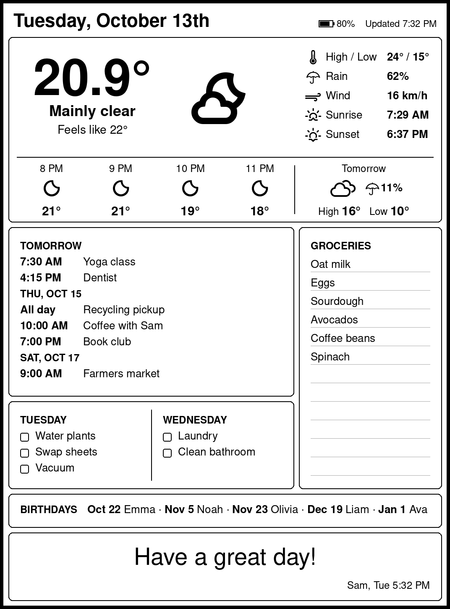

# Home Console 🏠📟

An e-ink kitchen dashboard: a Raspberry Pi renders the day (weather, calendar, chores, groceries, birthdays and a note) as a 1072×1448 PNG, and a jailbroken Kindle fetches and displays it every 10 minutes.



## Architecture

```text
[Open-Meteo]  [iCloud Calendar + Contacts]  [Google / Jane iCal links]  [Gmail IMAP]
       │                    │                          │                      │
       └────────────────────┴────────────┬─────────────┴──────────────────────┘
                                         ▼
[iPhone Shortcut] ── POST /reminders ──▶ [Raspberry Pi] (Flask / systemd)
                                         │  GET /text.png
                                         ▼
                                       [Kindle] (scriptlet loop + deep sleep)
```

## The Parts

### 1. Raspberry Pi server (`raspy_server/`)
A Flask app that draws the dashboard with Pillow on every request. Each tile is one file in `widgets/`:

| Widget | Source | Shows |
|---|---|---|
| `header.py` | Pi clock, Kindle battery | Date, Kindle battery %, last update |
| `weather.py` | Open-Meteo (no key) | Now, today's stats, next 4 hours, tomorrow with high/low and rain/snow chance |
| `calendar.py` | iCloud CalDAV + iCal links | Upcoming events for the next 14 days, as many as fit |
| `reminders.py` | iPhone Shortcut | Today's and the next day's chores, plus the grocery list |
| `birthdays.py` | iCloud Contacts (CardDAV) | Upcoming birthdays, first name + date |
| `email_note.py` | Gmail folder `Kindle_Console` | Latest email subject as a note, signed with the sender's first name |

Endpoints: `GET /text.png` (the dashboard) and `POST /reminders` (receives reminder lists).

### 2. Kindle scriptlet (`kindle/scriptlets/dashboard.sh`)
Runs on the Kindle: stops the Kindle UI, downloads `text.png` (sending its battery level along), draws it with `eips`, then deep-sleeps until the next 10-minute mark. It only wakes between 7:30 and 22:00.

### 3. iPhone Shortcut (Reminders)
Upgraded iCloud Reminders aren't reachable via CalDAV, so the phone pushes them to the Pi. One list per weekday (`Monday` … `Friday`), one `Weekend` list, and one `Grocery` list.

## Prerequisites

Local Hardware Used in my Setup
* **Raspberry Pi** (Raspberry Pi OS, on the home network)
* **Kindle 11th gen** (jailbroken, scriptlets enabled)
* **iPhone** with the Shortcuts app
* **iCloud** and **Gmail** accounts with app-specific passwords

## Setup

### 1. Pi server
```bash
git clone https://github.com/jeaend/home_console.git
cd home_console/raspy_server
python3 -m venv venv
source venv/bin/activate
pip install -r requirements.txt
sudo apt install -y fonts-urw-base35
```

### 2. Runtime Configuration
```bash
cp config.example.py config.py
nano config.py
chmod 600 config.py
```
- `EMAIL_USER` / `EMAIL_PASS`: Gmail address + app password. The note comes from the latest email in the `Kindle_Console` folder (use a Gmail filter to route mail there).
- `ICLOUD_USER` / `ICLOUD_APP_PASSWORD`: Apple ID + app-specific password (appleid.apple.com → Sign-In and Security → App-Specific Passwords). Used for calendar and birthdays.
- `CALENDAR_NAMES`: iCloud calendars to include; leave empty for all.
- `ICAL_URLS`: Extra calendars (Google "Secret address in iCal format", booking sites, subscriptions).
- Weather location: the latitude/longitude is set in `widgets/weather.py` (Toronto).

### 3. Background Service (systemd)
Create `/etc/systemd/system/raspy_server.service`:
```ini
[Unit]
Description=Raspy Kindle Dashboard Flask Server
After=network.target

[Service]
User=<username>
WorkingDirectory=/home/<username>/home_console/raspy_server
ExecStart=/home/<username>/home_console/raspy_server/venv/bin/python app.py
Restart=always
RestartSec=10

[Install]
WantedBy=multi-user.target
```
```bash
sudo systemctl daemon-reload
sudo systemctl enable --now raspy_server
journalctl -u raspy_server -f
```
Check it in a browser: `http://<pi_ip>:8080/text.png`

### 4. Kindle
1. Set `DASH_URL` in `dashboard.sh` to your Pi's IP.
2. Plug the Kindle in via USB and copy `dashboard.sh` into its scriptlets folder.
3. Unplug and tap **Home Console** in the library. The Kindle UI stops and the dashboard takes over.
4. To get back to the normal Kindle: hold the power button for ~40 seconds to restart.

### 5. iPhone Shortcut
1. **Find Reminders** where List is any of `Monday` … `Friday`, `Weekend`, `Grocery` (and *Is Completed* is off, if you tick things off).
2. **Repeat with Each** → **Text**: `Repeat Item›List: Repeat Item›Title`
3. **Combine Text** (Repeat Results) with New Lines.
4. **Get Contents of URL**: `http://<pi_ip>:8080/reminders`, Method **POST**, Request Body **JSON**, field `items` = Combined Text.
5. Automations (Run Immediately): **App → Reminders → Is Closed**, and **Time of Day → 6:00 AM**.

---

## Possible Extensions

* **Countdowns / days together:** a small tile counting down to trips or holidays.
* **Moon phase** in the weather tile.
* **Photo note:** an image attachment in the `Kindle_Console` email shown in place of the note.
* **Battery fix:** confirm deep sleep works so the Kindle lasts weeks per charge.
